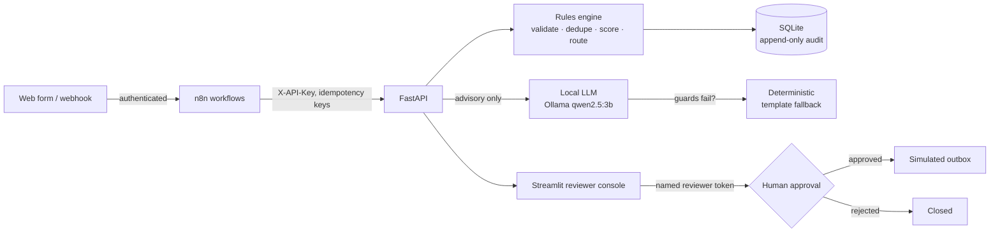

<div align="center">

# ✈️ FlowPilot AI

### AI-assisted lead-intake automation where humans keep the final say

[](https://flowpilot-hamaz.duckdns.org)
[](https://www.python.org/)
[](https://fastapi.tiangolo.com/)
[](https://n8n.io/)
[](https://ollama.com)
[](LICENSE)

**[🚀 Live Demo](https://flowpilot-hamaz.duckdns.org)** (no sign-up needed) · [How it works](#-how-it-works) · [Safety by design](#-safety-by-design) · [Results](#-results) · [Technical guide](docs/TECHNICAL.md)

</div>

---

## 🎯 The problem

A B2B consultancy gets inbound enquiries from web forms and email. Leads go cold while someone triages them by hand, and the obvious fix — "let an AI reply automatically" — is how companies end up emailing a hallucinated price to a prospect.

FlowPilot AI automates everything **up to** the decision and nothing past it. Built for *Northstar Digital Solutions*, a fictional consultancy:

- **Intake** — leads arrive via API or an authenticated n8n webhook; validated, de-duplicated and idempotent.
- **Score & route** — versioned deterministic rules send each lead to `partner_review`, `sales_queue` or `nurture`.
- **Draft** — a local LLM writes an advisory qualification and a reply draft, with a deterministic fallback.
- **Approve** — a named human reviewer approves or rejects the exact draft version.
- **"Send"** — approval writes to a **simulated** outbox. Nothing is ever emailed.

Synthetic data only, zero paid APIs, runs locally or on a free-tier server.

---

## 🔄 How it works



| Component | Role |
|---|---|
| **FastAPI** | The only writer to the database; enforces every rule |
| **n8n** (2 workflows) | Webhook intake and "prepare next lead" orchestration — can qualify and draft, can never approve or send |
| **Local LLM** | Qualification and reply drafts; output is advisory and never changes score, tier or route |
| **Reviewer console** | Streamlit: dashboard, leads, draft review with explicit confirmation, simulated outbox |
| **SQLite** | Checksummed migrations, triggers that make the audit log append-only and block outbox rows without an approved draft |

---

## 🛡️ Safety by design

The guardrails live in the **database and network**, not just in application code:

- **No path to a real send.** The only outbox channel is `simulated`; a trigger refuses outbox rows without a human-approved draft.
- **Humans are authenticated individually.** Approvals require a per-reviewer token (only its SHA-256 is stored); a trigger refuses approvals without an active reviewer.
- **LLM output has no authority.** Inputs are screened for prompt injection (after Unicode normalization, so zero-width and fullwidth tricks fail); outputs are schema-validated and guarded — no links, emails, phone numbers, prices or budget references — with automatic fallback on any failure.
- **n8n is network-isolated.** It sits on an internal Docker network with no route out; its only exits are two fixed-destination relays. Its API key is scoped to exactly the calls its workflows need.
- **Public demo is locked down.** TLS, rate limits per traffic class, security headers; only the console is exposed; the API stays on an internal network; the model is off and data refreshes hourly.
- **Privacy-safe logging.** JSON logs with request ID, route and timing only — no bodies, keys, tokens or lead data.

---

## 📊 Results

| What was measured | Result |
|---|---|
| Local LLM on 13 synthetic leads (`qwen2.5:3b`, prompt v2026.10-p3) | Qualification **13/13** and drafts **13/13** from the model — no fallbacks, no guard failures |
| Latency p50 (M1 MacBook Air) | Qualification 2.7 s · draft 3.2 s |
| Approvals / outbox during eval | Stayed empty (verified) — the model cannot approve |
| Test suite | 42 test modules, coverage gate ≥ 80%, all non-loopback network calls blocked |
| n8n workflows | Statically validated (node allowlist, fixed URLs, approved method/path pairs, idempotency keys) and contract-tested against FastAPI |

> **Honest read:** 13 leads on one machine shows the pipeline works — it is not a measured success rate for other leads, models or hardware. Drafts from a 3B model are generic starting points for human review.

---

## 🧰 Tech stack

| Layer | Tools |
|---|---|
| Backend | FastAPI, Pydantic, SQLite (WAL), custom checksummed migrations |
| Automation | n8n 2.44 (pinned by digest, hardened, 9-node allowlist) |
| AI | Ollama (`qwen2.5:3b`), structured JSON output, injection pre-screen, output guards |
| UI | Streamlit reviewer console |
| Ops | Docker Compose, nginx (TLS, rate limiting), uv, ruff, pytest + coverage |
| Docs | 5 Architecture Decision Records, operations & recovery runbook |

---

## ▶️ Run it locally

```bash
git clone https://github.com/hamazmubashar/flowpilot-ai.git
cd flowpilot-ai
uv sync
cp .env.example .env
uv run flowpilot-admin gen-key        # paste into FLOWPILOT_API_KEY in .env
uv run flowpilot-admin migrate
uv run flowpilot-admin seed           # 60 synthetic leads
uv run flowpilot-api                  # http://127.0.0.1:8000
uv run --group ui streamlit run src/flowpilot/ui/app.py   # reviewer console
```

API reference, n8n setup, LLM configuration, admin CLI and public-demo deployment: **[docs/TECHNICAL.md](docs/TECHNICAL.md)**. Design decisions: [docs/adr/](docs/adr/). Operations: [docs/runbook.md](docs/runbook.md).

---

## ⚠️ Known limitations

- SQLite means a single writer process; no horizontal scaling.
- The injection pre-screen is heuristic and will miss novel phrasings; the real defence is that model output has no authority.
- Output guards are strict and can reject legitimate drafts (they fall back to a template).
- The n8n "prepare next lead" workflow has been run end-to-end once against a scratch database.
- Reviewer tokens don't expire; the public demo token is shared by design.
- `qwen2.5:3b` is under a research licence — this is a non-commercial portfolio demo.

Full list: [docs/TECHNICAL.md](docs/TECHNICAL.md#known-limitations-m1m3).

---

## 📄 License

Code: MIT ([LICENSE](LICENSE)). n8n is used under its Sustainable Use License and is pulled at runtime, not bundled.

**Built by [Hamaz Mubashar](https://www.linkedin.com/in/hamazmubashar)** · Related: [LeadFlow AI](https://leadflow-hamaz.duckdns.org) · [More projects](https://github.com/hamazmubashar)
