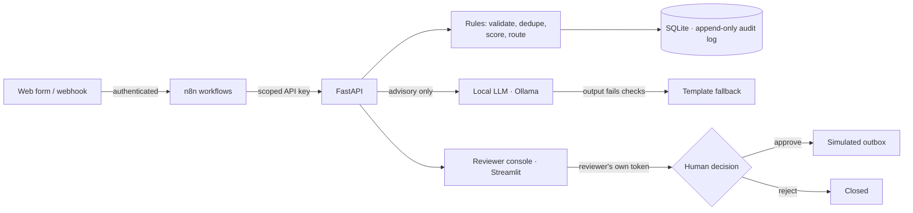

<div align="center">

# FlowPilot AI

**Lead-intake automation for a B2B consultancy. AI does the busywork; a person makes every decision.**

[](https://flowpilot-hamaz.duckdns.org)
[](https://www.python.org/)
[](https://fastapi.tiangolo.com/)
[](https://n8n.io/)
[](https://ollama.com)
[](LICENSE)

[**Try the live demo**](https://flowpilot-hamaz.duckdns.org) (one click, no sign-up) · [How it works](#how-it-works) · [Safeguards](#safeguards) · [Results](#results) · [Technical guide](docs/TECHNICAL.md)

</div>

---

## The problem

Inbound enquiries go cold while someone sorts through them by hand. The tempting fix is to let an AI reply automatically, and that's how a company ends up emailing a prospect a price its model made up.

FlowPilot takes a stricter line: **automate everything up to the decision, and nothing after it.** It's built for Northstar Digital Solutions, a fictional consultancy, and it handles a lead like this:

1. **Intake.** A lead arrives through the API or an n8n webhook. It's validated, checked for duplicates, and safe to resend.
2. **Score and route.** Versioned rules score it and send it to partner review, the sales queue, or nurture.
3. **Draft.** A local LLM writes a short qualification and a reply. If anything about the output looks wrong, a template takes over.
4. **Approve.** A named reviewer approves or rejects that exact draft.
5. **"Send".** An approved reply goes to a simulated outbox. Nothing is ever emailed.

Everything uses synthetic data and free tools, and it runs on a laptop or a free cloud server.

## Try the demo

Open the [live demo](https://flowpilot-hamaz.duckdns.org) and click **Explore the demo**. You'll be signed in as the demo reviewer: look through the scored leads, read the AI drafts, and approve or reject one to see it land in the simulated outbox. The data resets every hour, so you can't break anything.

## How it works



| Part | What it's responsible for |
|---|---|
| **FastAPI** | The only thing allowed to write to the database; every rule is enforced here |
| **n8n** | Two workflows: webhook intake, and "prepare the next lead". They can qualify and draft, but can't approve or send. |
| **Local LLM** | Writes qualifications and drafts. Its output is advice only and never changes a lead's score or route. |
| **Reviewer console** | Dashboard, leads, draft review with a confirmation step, and the simulated outbox |
| **SQLite** | Checksummed migrations, plus triggers that keep the audit log append-only and reject outbox rows without an approved draft |

## Safeguards

I put the important rules in the database and the network, not only in the application code, so a bug in one place can't quietly bypass them.

- **There's no way to send a real message.** The outbox's only channel is "simulated", and a database trigger refuses any entry without a human-approved draft.
- **Every approval belongs to a named person.** Reviewers have individual tokens (only a hash is stored), and the database rejects approvals that don't come from an active reviewer.
- **The AI has no authority.** Lead text is screened for prompt injection, including hidden zero-width and fullwidth-character tricks. Output is checked against a strict schema and rejected if it contains links, emails, phone numbers, prices or budget mentions, with a template used instead.
- **n8n can't reach the internet.** It runs on an internal Docker network whose only exits are two relays with fixed destinations, and its API key only allows the exact calls its workflows need.
- **The public demo is locked down.** TLS, per-route rate limits and security headers; only the console is exposed, the API stays internal, the model is switched off, and data resets hourly.
- **Logs contain no personal data.** Request ID, route and timing only: no bodies, keys, tokens or lead details.

Each of these decisions is written up in an [architecture decision record](docs/adr/).

## Results

| What I measured | Result |
|---|---|
| Local model on 13 synthetic leads (`qwen2.5:3b`) | All 13 qualifications and all 13 drafts came from the model, with no fallbacks and no failed checks |
| Speed (median, M1 MacBook Air) | 2.7 s per qualification, 3.2 s per draft |
| Approvals during that run | None. The outbox stayed empty, confirming the model can't approve anything. |
| Automated tests | 849 tests with an 80% coverage gate (currently 93%); any network call outside the machine fails the build |
| n8n workflows | Checked automatically against an allowlist of nodes, URLs and API calls, and replayed against the real API in tests |

Thirteen leads on one machine shows the pipeline works; it isn't a success rate you can expect for every lead or model. Drafts from a 3B model are fine as a starting point and still need a human to finish them, which is the point.

## Tech stack

| Area | Tools |
|---|---|
| Backend | FastAPI, Pydantic, SQLite, custom checksummed migrations |
| Automation | n8n 2.44, pinned and hardened |
| AI | Ollama (`qwen2.5:3b`), JSON-schema output, injection screening, output checks |
| Interface | Streamlit |
| Operations | Docker Compose, nginx, uv, ruff, pytest, coverage |
| Documentation | 6 architecture decision records and an operations runbook |

## Run it locally

```bash
git clone https://github.com/hamazmubashar/flowpilot-ai.git
cd flowpilot-ai
uv sync
cp .env.example .env
uv run flowpilot-admin gen-key        # paste the key into FLOWPILOT_API_KEY in .env
uv run flowpilot-admin migrate
uv run flowpilot-admin seed           # 60 synthetic leads
uv run flowpilot-api                  # API at http://127.0.0.1:8000
uv run --group ui streamlit run src/flowpilot/ui/app.py   # reviewer console
```

The [technical guide](docs/TECHNICAL.md) covers the full API, n8n setup, turning on the local model, the admin CLI and deploying the public demo. Day-to-day operations and recovery are in the [runbook](docs/runbook.md).

## Limitations

- SQLite allows one writer, so the API runs as a single process.
- Prompt-injection screening is pattern-based and will miss new phrasings. The real protection is that the model's output can't do anything on its own.
- The output checks are strict and sometimes reject a perfectly good draft, which then falls back to a template.
- The "prepare next lead" n8n workflow has only been run end to end once, against a test database.
- Reviewer tokens don't expire, and in the demo everyone shares one reviewer.
- `qwen2.5:3b` is under a research licence, so this is a non-commercial portfolio project.

The full list is in the [technical guide](docs/TECHNICAL.md#known-limitations-m1m3).

## Author

**Hamaz Mubashar** · [LinkedIn](https://www.linkedin.com/in/hamazmubashar) · [GitHub](https://github.com/hamazmubashar) · Related project: [LeadFlow AI](https://leadflow-hamaz.duckdns.org)

Code is released under the [MIT License](LICENSE). n8n is used under its Sustainable Use License; it's pulled at runtime, not bundled.
